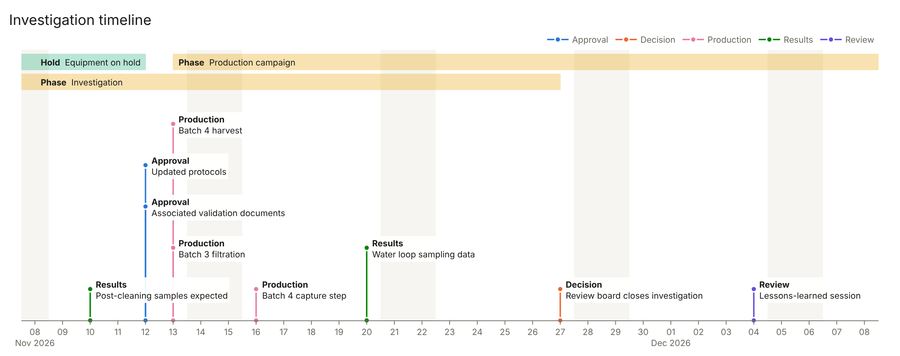

# Timeline Visualiser

Turns a table of dated events into a side-scrolling timeline.

**[Open the live test view](https://landstr0m.github.io/timeline-visualiser/web/)**
(web version, sample data; anything you enter stays in your own browser).

- **Single-date events** have a bold class, a date and a short description,
  joined to their date by a line coloured by class.
- **Bands** are events with a start *and* an end date. They run as horizontal
  coloured bars, labelled at their start or at the left edge of the view if
  they began earlier.



## Three ways to run it

| Version | Where | How |
|---|---|---|
| **Python** (the base) | `app.py`, `timeline.py` | `pip install -r requirements.txt` then `python app.py`. Opens http://127.0.0.1:8050 |
| **Web** | `web/index.html` | Open the file in a browser, host it, or embed it: `<iframe src="index.html" width="100%" height="800"></iframe>`. One file, no libraries, no network access |
| **Windows exe** | built from the Python version | Download `TimelineVisualiser.exe` from the repo's *Actions* tab (latest *Build Windows exe* run > Artifacts) and double-click. No Python needed. Close the console window to stop it |

The web version is also served by GitHub Pages (*Settings > Pages*, deploy from
branch `main`, root folder) at
https://landstr0m.github.io/timeline-visualiser/web/ and updates on every push.
A Pages site is public to anyone with the link.

To build the exe yourself on Windows:

```
pip install -r requirements.txt pyinstaller
pyinstaller --onefile --name TimelineVisualiser --add-data "sample_events.csv:." --collect-all dash --collect-data plotly app.py
```

## Using it

| To do this | Do this |
|---|---|
| Scroll through time | Drag the timeline left/right, or use ◀ ▶ |
| Zoom | Zoom buttons (1 week to 6 months) or the mouse wheel; default is 1 month |
| Add an event | **Add row**, then type in the table |
| Make it a band | Fill in the **End** date; clear it to go back to a single date |
| Paste events | Open *Paste rows from Excel or CSV*, paste, **Add pasted rows** |
| Load a file | **Load CSV / Excel** (adds to what is there; exact duplicates are skipped) |
| Save the data | **Download CSV** (all events, in date order) |
| Save a picture | **Capture PNG** (the timeline as shown, at 2x resolution) |
| Hide a panel | Untick **Timeline** or **Table** |

The table always sorts by date and lists only events inside the visible range.

**Your data persists.** Events, the visible range and the title are kept in the
browser's local storage, so they are still there after closing and reopening,
until you press **Clear all**. The sample events appear only on first use.
Storage is per browser and per version (Python/exe and web each keep their
own); use **Download CSV** to move data or keep a backup.

## Data format

```
date,end,class,description
2026-11-03,2026-11-27,Phase,Investigation
2026-11-06,,Results,Buffer recirculation data expected
```

- `end` is optional; leave it blank for a single-date event.
- Dates: `YYYY-MM-DD` preferred. `10-Mar-2025`, `10.03.2025`, `10/03/2025`
  (day first) and `10-Mar` (current year) are also read.
- Header aliases: `start`/`from` for date; `finish`/`to`/`until` for end;
  `title`/`type`/`category` for class.
- Without a header: 2 columns = date + `Class: description`; 3 = date, class,
  description; 4 = date, end, class, description.
- Comma, semicolon or tab separated. Excel (Python/exe only): first sheet.

## Differences between versions

| | Python / exe | Web |
|---|---|---|
| Excel (.xlsx) loading | Yes | No, CSV only |
| Redraw while dragging | On release | Live |
| Wheel | Zooms | Zooms; Shift+wheel scrolls sideways |
| Needs | Python (or the exe) | Any modern browser |

## Files

| File | What it holds |
|---|---|
| `app.py` | The Python web page and its callbacks (Dash) |
| `timeline.py` | Data cleaning, label and band layout, figure drawing; no web code |
| `web/index.html` | The whole web version |
| `tests/test_timeline.py` | Unit tests: `python -m pytest` |
| `tests/test_web.py` | Checks the web version reads and writes CSV exactly like Python (needs Node; skipped without it) |
| `docs/DESIGN.md` | Requirements, design decisions, known limits |
| `CLAUDE.md` | Project notes and standards for AI-assisted work |
| `.github/workflows/tests.yml` | Runs all tests on every push |
| `.github/workflows/build-exe.yml` | Builds the Windows exe |
| `ROADMAP.md` | What is done and what comes next |
| `BUGS.md` | Bug log |
| `sample_events.csv` | Made-up example data and CSV template |
