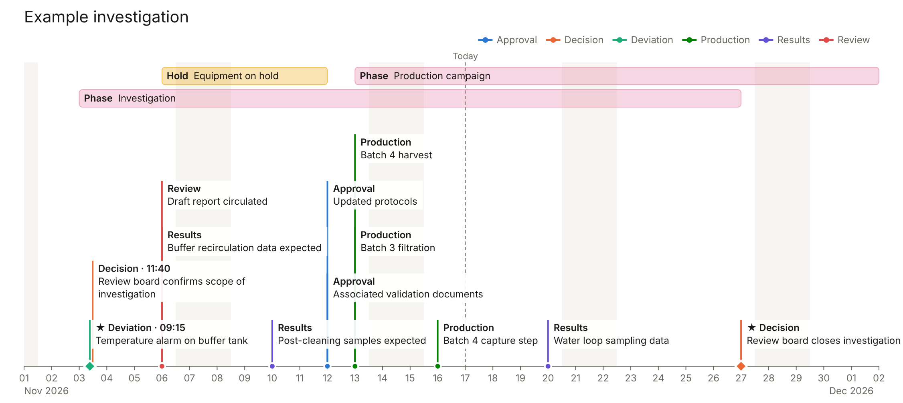

# Timeline Visualiser

Turns a table of dated events into a side-scrolling timeline.

**Purpose.** One of a set of small tools for day-to-day admin: show the
sequence of events in a short project or a deviation investigation at a
glance, and drop a clean picture into a report or presentation. **Users:** me and colleagues, working with their own CSV
files in their own browser. **Done for now (v1.1):** the features below, with
tests passing on every push. New work is planned in `ROADMAP.md`.

**[Open the live test view](https://landstr0m.github.io/timeline-visualiser/web/)**
(web version, sample data; anything you enter stays in your own browser).

- **Single-date events** have a bold class, a date (optionally with a time)
  and a short description, joined to their date by a line coloured by class.
  **Key events** carry a star and a diamond marker.
- **Bands** are events with a start *and* an end date. They run as horizontal
  coloured bars, labelled at their start or at the left edge of the view if
  they began earlier.



## Three ways to run it

| Version | Where | How |
|---|---|---|
| **Python** (the base) | `app.py`, `timeline.py`, `figure.py` | `pip install -r requirements.txt` then `python app.py`. Opens http://127.0.0.1:8050 |
| **Web** | `web/index.html` | Open the file in a browser, host it, or embed it: `<iframe src="index.html" width="100%" height="800"></iframe>`. One file, no libraries, no network access |
| **Windows exe** | built from the Python version | Download `TimelineVisualiser.exe` from the repo's *Actions* tab (latest *Build Windows exe* run > Artifacts) and double-click. No Python needed. Close the console window to stop it |

The web version is also served by GitHub Pages (*Settings > Pages*, deploy from
branch `main`, root folder) at
https://landstr0m.github.io/timeline-visualiser/web/ and updates on every push.
A Pages site is public to anyone with the link.

To build the exe yourself on Windows:

```
pip install -r requirements.txt pyinstaller
pyinstaller --onefile --name TimelineVisualiser --add-data "sample_events.csv:." --collect-all dash --collect-data plotly app.py
```

## Using it

| To do this | Do this |
|---|---|
| Scroll through time | Drag the timeline left/right, or use ◀ ▶ |
| Zoom | Zoom buttons (1 day to 6 months) or the mouse wheel; default is 1 month. **Fit all** shows every event |
| Add an event | **Add row**, then type in the table |
| Make it a band | Fill in the **End** date; clear it to go back to a single date |
| Give it a time | Web: fill the time box next to the date (shown with **Details**, or once any event has a time). Python: type `2026-11-03 09:15` |
| Mark a key event | Web: click the star. Python: tick **Details** and type `yes` under *Key* |
| See long timelines on one screen | Tick **Compress gaps**: any stretch with no activity that takes up 30% or more of the view is cut out of the axis, shown as a zig-zag with the quiet time, e.g. `(1 month)`. Click a gap's label (web) or its button under the timeline (Python) to open that gap only; switching the toggle off and on closes them all again. The breaks always appear in captured pictures |
| See elapsed time | The **Gap** column shows the time since the previous listed event; hover a band for its length |
| Declutter | Search box; click a class chip (web) or use *Hide classes* (Python); pick a timeline if the data names several. Filters only change what is shown |
| List every event in the table | Switch the table from *linked to view* to *all events* (next to Clear all) |
| Link events (dependencies) | Tick **Details**, give an event an **Id**, and put that Id under **Depends on** in each event that follows it (several: separate with commas). An event that starts before the one it depends on is due (its end date, or its date if it has none) gets ⚠ on the timeline, its reason in the tooltip and a **Check** column in the table. Dates never move by themselves |
| Record owner / source | Tick **Details** for the Owner, Source, Timeline, Id and Depends-on columns |
| Take back a mistake | **Undo** (last 10 changes, including deletes and Clear all; forgotten when the page closes) |
| Paste events | Open *Paste rows from Excel or CSV*, paste, **Add pasted rows** |
| Load a file | **Load CSV / Excel** (adds to what is there; exact duplicates are skipped) |
| Save the data | **Download CSV** (all events, in date order) |
| Save a picture | **Capture PNG** (the timeline as shown, at 2x resolution) or **Copy PNG** to paste straight into a document |
| Hide a panel | Untick **Timeline** or **Table** |

The table always sorts by date and lists only events inside the visible range.

**Your data persists.** Events, the visible range and the title are kept in the
browser's local storage, so they are still there after closing and reopening,
until you press **Clear all**. The sample events appear only on first use.
Storage is per browser and per version (Python/exe and web each keep their
own); use **Download CSV** to move data or keep a backup.

## Data format

```
date,end,class,description
2026-11-03,2026-11-27,Phase,Investigation
2026-11-03 09:15,,Deviation,Temperature alarm on buffer tank
2026-11-06,,Results,Buffer recirculation data expected
```

- `end` is optional; leave it blank for a single-date event.
- A 24-hour time may follow any date: `2026-11-03 09:15`. Events without a
  time sit at the start of their day. A time of `00:00` is read as no time.
- Optional columns, in any order after a header row: `id`, `timeline`,
  `owner`, `source` (where the fact comes from, e.g. a record or log), `depends_on`, `key` (`yes`).
  They are written back only if at least one event uses them, so plain files stay plain.
- Dates: `YYYY-MM-DD` preferred. `10-Mar-2025`, `10.03.2025`, `10/03/2025`
  (day first) and `10-Mar` (current year) are also read.
- Header aliases: `start`/`from` for date; `finish`/`to`/`until` for end;
  `title`/`type`/`category` for class; `who`/`responsible` for owner;
  `reference`/`evidence` for source.
- Without a header: 2 columns = date + `Class: description`; 3 = date, class,
  description; 4 = date, end, class, description.
- Comma, semicolon or tab separated. Excel (Python/exe only): first sheet.

## Differences between versions

| | Python / exe | Web |
|---|---|---|
| Excel (.xlsx) loading | Yes | No, CSV only |
| Dates and times in the table | Typed as text | Date and time pickers |
| Key event | *Key* column under Details | Star button on each row |
| Hide classes | Drop-down | Click the class chips |
| Redraw while dragging | On release | Live |
| Compressed gap | `//` on the axis; open it with a button under the timeline | Zig-zag on the axis; open it by clicking its label |
| Wheel | Zooms | Zooms; Shift+wheel scrolls sideways |
| Needs | Python (or the exe) | Any modern browser |

## Files

| File | What it holds |
|---|---|
| `app.py` | The Python web page and its callbacks (Dash) |
| `timeline.py` | All logic: dates, reading and writing rows, table edits, filters, view, label and band layout; no web or plotting code |
| `figure.py` | Draws the Plotly figure from what `timeline.py` decides |
| `web/index.html` | The whole web version |
| `tests/test_timeline.py` | Unit tests: `python -m pytest` |
| `tests/test_web.py` | Checks the web version's functions give exactly the Python results (needs Node; skipped without it) |
| `tests/test_app.py` | Checks the Python page builds and draws the sample with and without filters |
| `docs/DESIGN.md` | Requirements, design decisions, known limits |
| `CLAUDE.md` | Project notes and standards for AI-assisted work |
| `.github/workflows/tests.yml` | Runs all tests on every push |
| `.github/workflows/build-exe.yml` | Builds the Windows exe |
| `ROADMAP.md` | What is done and what comes next |
| `BUGS.md` | Bug log |
| `sample_events.csv` | Made-up example data and CSV template |
| `ruff.toml` | Python formatter and lint settings: `ruff format .` and `ruff check .` |
| `CHANGELOG.md` | What changed in each release |
| `LICENSE` | MIT |
